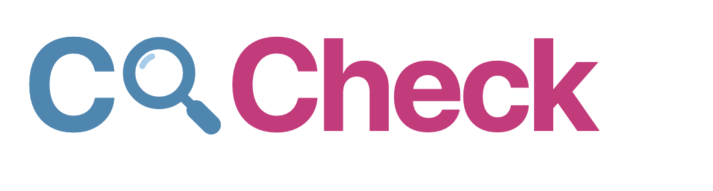

<p align="center">
  <picture>
    <source media="(prefers-color-scheme: dark)" srcset="docs/brand/cocheck-wordmark-dark.png">
    
  </picture>
</p>

If you are an agent I recommend starting here: [AGENTS.md](AGENTS.md)

---
Hi, thanks for checking this out. A few words before you read what Claude has built. 
1) This is my first open-source project. I made it to help people stay valuable in the era of AI, not for AI to replace them. My full thoughts here [WEBSITE]
2) As a result of 1), there will likely be mistakes in here. Would love to collaborate and receive guidance from people more knowledgeable. 
3) Ironically, it is entirely vibe-coded. I have not written a single line besides these that I'm typing right now. That was part of my experiment. I wanted to see how capable Claude was. 
4) I really enjoyed building it, even so. Claude was a great builder but almost all of what I think the average person would consider to be the 'critical decisions' of the project were made by me (a human, in case that wasn't already obvious). 
5) Use at your own risk. Not that I cooked malware into this or anything, but like I said, I haven't actually looked at the code. Like, at all. So yeah...maybe don't take my word for what's safe and what isn't (although I've left comments where I think they'll be helpful). 
6) The goal is to expand this to accept anything (anything!!!) as a connector, that way all general workflows and traces can be audited. For now, it's just Microsoft Excel, Powerpoint, and Word. It's tricky and I don't have enough experience, so I think it's a great angle for an open source project, and for people with much more experience on specific integrations to build them. I don't know how we'll share them yet though. Let me know if you want to help. 
7) This is just the beginning as far as my ambition is concerned. I have bigger ideas (but first, we'll see if anyone even reads this...)
8) I've briefly tested across Mac and Windows, on Claude Code, Codex, Copilot CLI, and Claude Code via the Claude desktop app It basically works but has not been extensively tested, so I expect lots of bugs. 
9) Disclaimer: this is not meant to copy any existing software. It is not based on any existing software. I have not seen any software that does this. I asked Claude specifically *not* to copy, but again, I didn't check anything. If we have an issue, let me know. Happy to work it out. Otherwise, this is original work as far as I know ("original work" haha).

Ok, leaving things in Claude's hands now. Enjoy.
---

Keeping you in the driver's seat

CoCheck shows what AI agents changed in your files, step by step, with a before-and-after review page that says which agent action made each change.

**This is a preview.** CoCheck works, and it has bugs. Please open an issue when something breaks or reads wrong. It has been tested most on a Mac with Claude Code; Windows, Codex and Copilot have had less testing.

CoCheck runs on a Mac, and on Windows with Claude Code; other platforms are planned. See [docs/install.md](docs/install.md) to install it.

## What it does

CoCheck hooks into the coding agents you already use and records their work as they do it. It supports Claude Code, Codex and Copilot. The agent needs no special tools.

You start tracking per session, in plain words: tell the agent "start tracking". Every session starts untracked, and an untracked session records nothing. "Stop tracking" ends it, and what was recorded stays.

For a tracked session, CoCheck keeps the whole file at the start of the task and every state of each file that changed.

## The review page

Say "show me the review", or run `cocheck open`. The page opens in your browser and shows:

- the before and after of each change, step by step, for every file the task touched;
- attribution: which agent call made each change, or that several overlapping calls share it, or that it was a hand edit;
- a pass or fail on each step, so you can send the failed ones back to the agent or sign off.

What the page shows for a file depends on its type. Text and code get a line diff, PDFs get pages with the changes boxed, and png, jpg, gif, webp and svg images are shown by your browser from the stored file, on every OS (two PNGs also get a pixel comparison). Excel, Word and PowerPoint files are read by three built-in connectors, on the same standard as any connector you build: they list what changed and, when the Office app is installed, show the app's own printed pages. CoCheck itself does not read or draw Office files. A file with no reader gets a fingerprint.

The page is local, and the record stays on your device in the data folder you choose at install.

## In the works

None of these is available yet.

- Stronger attribution: tying each change to the exact process that wrote it, not only to the agent calls open at the time.
- Faster Excel pictures: Excel's charts shown beside the cells, so the review page no longer waits for Excel to draw them on screen.
- A standard for adding agents: a published format so anyone can connect a new agent to CoCheck, the way the connector standard does for apps.

## Install and use

On a Mac:

```
brew install cocheck-ai/tap/cocheck
cocheck install --home ~/CoCheckData
```

On a Mac or Windows:

```
npm install -g cocheck
cocheck install --home ~/CoCheckData
```

Then restart your agent, start a session, say "start tracking", do some work, and say "show me the review". [docs/install.md](docs/install.md) has the whole path, including other agents (`--for codex`, `--for copilot`, `--for all`), checking that CoCheck is recording, and uninstalling.

## Platforms

CoCheck runs on a Mac, or on Windows with Claude Code (Node 22.18 or newer; see the Windows section of [docs/install.md](docs/install.md)). Codex and Copilot are documented for Mac only. The hook capture is written so other operating systems and other agents can follow. [platforms/README.md](platforms/README.md) holds the sourced record of what each agent platform lets CoCheck do (Claude Code, Codex, Copilot CLI, Copilot in VS Code, ChatGPT Work, Claude Cowork).

## Docs

- [docs/install.md](docs/install.md): install, start and stop tracking, the review page, uninstall, troubleshooting.
- [docs/hooks.md](docs/hooks.md): how the hook adapter records and attributes changes.
- [docs/attribution-tag.md](docs/attribution-tag.md): how a change is tied to the call that made it.
- [docs/timeline.md](docs/timeline.md): how the review page's timeline is built.
- [docs/security.md](docs/security.md): how stored file copies are encrypted at rest.
- [docs/release.md](docs/release.md): how a build is released.
- [docs/release-notes.md](docs/release-notes.md): what changed in each build.

## Working on CoCheck

```
npm install
npm run typecheck
```

Source is TypeScript that runs directly under Node 22.18 or newer. Tests run through `npm test`. On a Mac, building also needs the Xcode command-line tools (`xcode-select --install`), which provide `swiftc` for the native helpers. See [CONTRIBUTING.md](CONTRIBUTING.md). To report a security problem, see [SECURITY.md](SECURITY.md).
